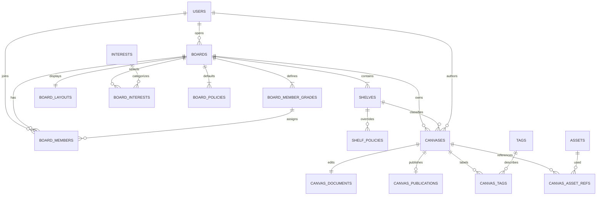

# 도메인과 데이터 모델

[진입점](README.md) · [권한](membership-policy.md) · [API](api-design.md)

## 서비스 경계

FastAPI 모듈러 모놀리스를 유지한다. `routers/v1/<domain>.py → services/<domain>.py → models/<domain>.py`와 도메인 에러 모듈의 기존 경계를 사용한다. BoardService는 생성 트랜잭션을 조정하고 MembershipService는 역할/등급/상태 및 BoardPermissionService를 소유한다. ShelfService는 분류/정책, CanvasService는 게시 수명주기/메타데이터/문서, MediaService는 에셋, DiscoveryService는 권한이 적용된 목록을 소유한다.

현재 `get_db()`는 세션 수명만 관리하며 자동 commit하지 않는다. 복합 생성 작업의 하위 repository가 각각 commit하는 기존 단일 작업 패턴을 복제하지 않는다. 서비스가 `async with session.begin()`을 열고 하위 저장소에 같은 세션을 전달한다. 객체 저장소 호출은 DB 트랜잭션과 원자적이지 않으므로 파일 실패 보상을 별도로 처리한다.

그림의 필수 관계는 생성 트랜잭션 완료 시 조건이다. 아래 DB 제약과 서비스 검증을 함께 적용한다.

## 공통 규약

- 새 Board/Shelf/Canvas/Grade/Asset/Tag는 앱이 UUID v4를 생성한다. JSON은 UUID 문자열, PostgreSQL은 UUID다. 기존 users.id/interests.id는 정수이며 공식 Interest API id는 기존 slug 문자열을 유지한다.
- API 필드는 기존 `snake_case`로 통일한다. 본문 문서도 `schema_version`을 쓴다. 제안 예제의 camelCase는 설명용이며 이중 별명 입력은 받지 않는다.
- 시각은 서버 생성 UTC `TIMESTAMPTZ`, JSON ISO 8601. created_at은 불변, updated_at은 변경 시 갱신한다. FK/정렬 인덱스와 페이지 cursor를 위한 `(published_at,id)` 인덱스를 둔다.
- 문자열 enum은 CHECK/애플리케이션 enum으로 제한한다. DB native enum은 사용하지 않아 SQLite 테스트와 확장을 유지한다. JSON은 SQLAlchemy JSON + PostgreSQL JSONB variant, UUID는 SQLAlchemy Uuid를 사용한다. SQLite 통과가 PostgreSQL 잠금/제약 통과를 대체하지 않는다.

## 테이블과 주요 필드

| 테이블                | 주요 필드·정책                                                                                                                                                                                                                                                                                                                       |
| --------------------- | ------------------------------------------------------------------------------------------------------------------------------------------------------------------------------------------------------------------------------------------------------------------------------------------------------------------------------------ |
| boards                | id PK, owner_id FK users RESTRICT, slug VARCHAR(64) UNIQUE NOT NULL, name VARCHAR(80), description TEXT 기본 빈값(최대 2,000), rules TEXT(최대 10,000), visibility public/private, join_policy open/invite, status active/suspended/archived, avatar_asset_id/cover_asset_id nullable, revision BIGINT 기본 0, created_at/updated_at |
| board_interests       | (board_id,interest_id) PK, position. 기존 활성 공식 Interest에서 0~3개. Board 수정 시 중복·비활성·수량 검사                                                                                                                                                                                                                          |
| board_member_grades   | id PK, board_id FK, name VARCHAR(30), rank INTEGER >=0, is_default BOOL, created_at/updated_at. UNIQUE(board_id,id), UNIQUE(board_id,name), UNIQUE(board_id,rank), Board별 is_default 부분 유니크                                                                                                                                    |
| board_members         | (board_id,user_id) PK, role owner/admin/moderator/member, status active/pending/suspended/banned, grade_id NOT NULL, joined_at. 복합 FK(board_id,grade_id), role=owner 부분 유니크                                                                                                                                                   |
| board_policies        | (board_id,action) PK, audience public/members, min_grade_id nullable, staff_bypass BOOL. staff_only BOOL 기본 false. members+staff_only=false면 min_grade_id 필수, public 또는 staff_only=true면 null. 같은 Board grade FK                                                                                                           |
| shelf_policies        | (board_id,shelf_id,action) PK, 위와 동일. 행이 없으면 Board 정책 상속. 부분 필드가 아닌 액션 정책 전체를 재정의. Shelf/Grade 복합 FK                                                                                                                                                                                                 |
| board_member_audit    | id UUID, board_id FK, actor_user_id/target_user_id nullable FK SET NULL, before/after JSONB(역할·등급·상태·정책 식별자만), reason VARCHAR(500), created_at. 조회는 Owner/Admin, 보존 180일 후 삭제 작업                                                                                                                              |
| board_layouts         | board_id PK/FK, document JSONB, revision BIGINT >=0, updated_at                                                                                                                                                                                                                                                                      |
| shelves               | id PK, board_id FK, slug VARCHAR(64), name VARCHAR(80), description VARCHAR(2,000), icon 허용 아이콘 키(최대 40), sort_order INTEGER >=0, purpose general/notice, classification manual, is_visible BOOL, is_default BOOL, created_at/updated_at. UNIQUE(board_id,slug), UNIQUE(board_id,id), Board별 기본 부분 유니크               |
| canvases              | id PK, board_id/shelf_id NOT NULL 복합 FK, author_id nullable FK SET NULL, title VARCHAR(200), summary VARCHAR(500), thumbnail_asset_id nullable, status draft/published/archived/trashed, visibility public/members, revision BIGINT 기본 0, published_at nullable, trashed_at nullable, created_at/updated_at                      |
| canvas_documents      | canvas_id PK/FK, document JSONB, revision BIGINT >=0, updated_at. 편집 중인 현재 초안 한 개                                                                                                                                                                                                                                          |
| canvas_publications   | canvas_id PK/FK, publication_revision BIGINT, source_document_revision, source_metadata_revision, document JSONB, metadata JSONB(공개 제목/요약/태그 ID·표시명/썸네일), published_at. 현재 공개 snapshot 한 개만 보관                                                                                                                |
| tags / canvas_tags    | tags(id,name VARCHAR(40),normalized_name VARCHAR(80) UNIQUE), canvas_tags(canvas_id,tag_id) PK. NFC+trim+casefold 정규화, 표시명은 최초 생성값. Canvas당 10개. 기존 공식 Interest와 별도                                                                                                                                             |
| assets                | id, owner_id nullable, board_id nullable, canvas_id nullable, object_key UNIQUE, storage_fingerprint, mime_type/bytes/width/height/state pending/ready, created_at. Board 브랜드와 게시글 소유 범위를 구분                                                                                                                           |
| asset_deletion_outbox | id, object_key/storage_fingerprint, available_at/attempts/status. Board 삭제와 같은 트랜잭션에 기록하고 FK 없이 참조 재검사 후 파일을 삭제. worker 실패 시 지수 backoff·최대 횟수/운영 재처리                                                                                                                                        |
| canvas_asset_refs     | (canvas_id,asset_id,scope draft/publication) PK. JSON 안 asset 참조를 검증/추출하여 저장과 같은 DB 트랜잭션에 반영. 파일 정리 시 두 scope 모두 확인                                                                                                                                                                                  |

기존 users가 프로필을 보유하므로 새 profiles 테이블로 복사하지 않는다. 댓글/좋아요/구독/조회 통계·자동 승급 지표는 #26 이후 마이그레이션에서 만든다. tags 자체의 존재는 공개 검색 가능하지만 제한 콘텐츠의 연결/건수는 노출하지 않는다.

등급 rank/기본 등급/단일 Owner의 **존재**는 부분 유니크만으로 강제되지 않는다. 해당 Board 행을 FOR UPDATE로 잠그고 최소 1개 등급·정확히 1개 기본 등급·owner_id와 활성 Owner 멤버 일치를 서비스에서 commit 전에 검사한다. Owner를 중복으로 두지 않으며 여러 운영자는 Admin/Moderator로 지정한다. 소유권 이전은 전용 Owner 액션으로만 수행하며 일반 멤버 PATCH에서 owner 지정은 거부한다.

## 생성·수정 트랜잭션

1. 인증·생성 제한(활성/보관 포함 사용자당 최대 20 Board, 생성 트랜잭션에서 User 행 잠금 후 수량 재검사), slug 정규식 `^[a-z0-9]+(?:-[a-z0-9]+)*$`/3~64자와 예약어 `new/settings/admin` 검사.
2. Board INSERT. 기본 등급 Newcomer(뉴커머, rank 0), Pinner(피너, 10), Curator(큐레이터, 20), 각 액션의 Board 기본 정책 생성.
3. Owner 활성 멤버 등록(기본 뉴커머 grade_id 사용하되 운영 액션은 role로 판단).
4. 기본 자유 Shelf(general/manual/default)와 공지 Shelf(notice/manual) 생성. 공지는 글쓰기·댓글 운영 역할 제한 정책 적용.
5. 공식 Interest 연결, 기본 widgets 홈 레이아웃 revision 0 생성, 감사 기록 저장 후 commit.
6. 유니크 경쟁/중간 오류 시 전부 rollback. 외부 파일 업로드는 생성 트랜잭션 안에서 하지 않는다.

등급/정책/역할/상태 변경은 Board 행을 먼저 잠그고 수정+감사를 commit한다. Shelf 순서 변경은 전체 Shelf ID 집합(숨김 포함)을 중복/타 Board/누락 없이 받고 같은 트랜잭션에서 연속 순번을 부여한다. 등급 정렬은 rank 0,10,20…으로 재부여하며 PostgreSQL/SQLite 모두 트랜잭션 안에서 임시 고순위로 이동한 뒤 최종 rank를 부여하는 두 단계 변경을 사용한다. 초기 생성 migration은 즉시 고유 제약을 적용한다. 사용 중 등급 삭제는 같은 Board replacement_grade_id 필수, 멤버·정책 참조를 바꾸고 마지막 등급 삭제는 거부한다.

## Canvas 수명주기와 공개본

| 액션            | 출발 → 도착                        | 저장·노출                                                                                               |
| --------------- | ---------------------------------- | ------------------------------------------------------------------------------------------------------- |
| create          | 없음 → draft                       | 제목+빈 문서 revision 0 생성, 공개 snapshot 없음                                                        |
| save            | draft/published → 동일             | 초안 문서만 revision 증가. 게시중인 경우도 공개본 불변                                                  |
| publish         | draft/published → published        | 기대 문서/메타 revision 비교, 제목·문서·에셋 검증 후 현재 공개 snapshot 교체. publication_revision 증가 |
| unpublish       | published → draft                  | snapshot 삭제 및 publication 에셋 참조 해제. 초안 유지                                                  |
| archive         | draft/published → archived         | 메타데이터 PATCH 전용 액션으로 보관. 공개 snapshot 제거, 작성자는 조회만 가능                           |
| restore archive | archived → draft                   | 명시 PATCH 후 초안 편집 재개. 자동 재게시하지 않음                                                      |
| delete          | draft/published/archived → trashed | snapshot 제거, trashed_at 기록. 기본 30일 보관                                                          |
| restore trash   | trashed → draft                    | 30일 이내 작성자 복구. 자동 재게시하지 않음                                                             |
| purge           | trashed → 제거                     | 30일 후 DB 참조 제거, 미참조 파일 비동기 정리. 물리 파일 삭제 성공을 DB 트랜잭션으로 보장하지 않음      |

POST publish는 expected_document_revision, expected_metadata_revision을 받고 Canvas 행 잠금 → 현재 권한·Board/Shelf 상태 검사 → 초안 행 잠금 → revision 검증 → snapshot/메타/참조를 함께 commit한다. 저장·이동·게시 취소도 같은 잠금 순서(Board → Canvas → Document)를 유지한다. 문서 갱신은 조건부 UPDATE와 RETURNING으로 최종 CAS를 수행한다.

게시글 이동은 동일 Board 내 Manual Shelf만 허용한다. 이동 즉시 새 Shelf 권한이 적용되며 공개 snapshot 제목/본문은 유지한다. 새 Shelf에서 공개 visibility가 허용되는지 검사한다. 공개 제목/태그/미리보기 수정은 재게시 때 반영한다. 읽기 응답은 현재 Board/Shelf/멤버 권한을 재검사한 뒤 공개 snapshot에서 가져온다.

Board archived는 읽기와 Owner의 명시적 복원·소유권 이전만 허용, suspended는 일반 사용자에게 404를 반환하고 작성/운영 변경도 차단한다. 서비스 운영자의 정지/해제는 기존 앱 관리자 기능과 분리한 후속 관리 경로다. Board 영구 삭제는 archived 상태의 Owner가 confirm_slug와 expected_revision을 지정한 전용 DELETE에서만 허용한다. Board·멤버·정책·Shelf·Canvas·공개본·댓글/좋아요/구독(구현 후)을 같은 트랜잭션에서 삭제하고, 파일 키/저장 위치를 삭제 outbox에 남겨 commit 후 재시도 가능한 정리를 수행한다. 삭제 outbox는 Board FK를 두지 않아 부모 삭제 뒤에도 남으며 다른 Board/프로필의 공유 참조가 있는 파일은 제거하지 않는다. API는 DB 삭제 완료를 반환하며 파일 물리 삭제 완료를 보장하지 않는다. UI에서 다른 작성자의 게시글도 사라짐을 명시적으로 확인한다. 비어 있지 않은 Shelf와 기본 Shelf 삭제는 409. 빈 비기본 Shelf만 운영자가 삭제할 수 있다.

계정 삭제 시 소유 Board가 있으면 기존 탈퇴에 **409 BOARD_OWNERSHIP_REQUIRED**를 추가하고 먼저 활성 멤버에게 소유권을 이전하도록 한다. POST ownership-transfer는 기존 Owner를 Admin으로 내리고 대상 active 멤버를 Owner로 바꾸며 owner_id·감사를 같은 트랜잭션에서 갱신한다. Board를 먼저 잠그고 기존 Owner를 먼저 해제해 부분 유니크를 지키며 실패 시 전부 rollback한다. 마지막 Owner를 삭제하거나 비활성/타 Board 멤버에게 이전할 수 없다. sole Owner가 넘길 대상이 없으면 Board 보관→명시적 영구 삭제 후 계정을 삭제할 수 있다. #22에서 이 종료 경로와 파일 삭제 outbox까지 구현한 후 계정 삭제 소유 검사를 활성화한다. 일반 탈퇴 사용자 문서 author_id는 SET NULL로 익명화하고 문서 공개 상태는 유지한다. 삭제된 계정 에셋의 정리는 공개/초안 참조를 확인한다. 이 기존 탈퇴 계약 영향은 #22 구현에서 양쪽 OpenAPI·테스트·설명과 함께 적용한다.

## JSON 문서와 버전

Content v1은 `schema_version`, `engine`(name/version/adapter_version), `settings`, `nodes`, `edges`를 갖는다. [편집기 어댑터](editor-decision.md)처럼 엔진 필드의 손실 없는 보존과 서버 허용 타입 검증을 병행한다. text/image/drawing/shape만 nodes, 연결선은 edges. 전체 z 순서는 element_order로 보존하며 engine_element의 고정 버전 필드를 검증한다. node/edge ID는 문서 내 유일한 길이 1~80 문자열이며 동일 문서 안 참조만 허용한다. 자유 화살표의 source/target은 null을 허용한다.

기본 세계 크기 3200×2100, 좌표는 유한값·절댓값 최대 100,000, size는 일반 shape/image는 양수 최대 100,000, edge/drawing은 각 축 0 이상이며 둘 다 0은 거부한다. 줌은 임시 상태다. 본문 최대 UTF-8 JSON 2 MiB, 노드+연결선 합계 2,000, text 노드당 20,000자, drawing당 point 20,000. 수치는 MVP 거부 상한이며 성능 보장은 아니다. 이미지 바이너리는 JSON에서 제외하고 asset_id로만 참조한다.

UI v1은 schema_version/widgets만 사용한다. 위젯 최대 100개·256 KiB, 허용 타입 board_intro/canvas_collection/shelf_navigation/board_cover. source는 현재 Board 안의 Shelf·latest·limit 1~20만 허용한다. 임의 SQL·JavaScript·외부 HTML/URL 실행·타 Board source를 거부한다. document와 layout은 서로 다른 validator를 사용한다.

알 수 없는 schema/adapter/engine 버전은 422, 기존 문서의 이관 필요 상태는 409 DOCUMENT_UPGRADE_REQUIRED. 자동으로 손실 변환해서 저장하지 않는다. 다운그레이드 클라이언트는 읽기 전용/업데이트 안내로 전환한다. DB snapshot은 공개 revision 하나와 편집 초안 하나이며 무한 이력은 제공하지 않는다.

## 단계별 마이그레이션

현재 head는 0023_broaden_interest_catalog다. 아래 번호는 예약하지 않으며 구현 시 실제 head의 다음 번호를 사용한다.

1. #22/#23: Board/등급/멤버/정책/감사/Shelf/홈/Interest. 신규 테이블만 생성하고 기존 users/Interest 데이터는 보존한다. 계정 삭제 소유 검사는 Board 종료/에셋 정리 기반까지 연결한 뒤 활성화한다.
2. #8 기반/#24: Canvas/Document/Publication/Tag, 복합 FK·조회 인덱스. 초기 빈 문서 생성은 API에 연결할 때 함께 구현한다.
3. #6: Asset와 참조. 기존 profile_photo는 자동 이전하지 않는다.
4. #7/#8: 문서 CAS·게시 snapshot·공개 조회 및 브라우저 복원. 필요한 컬럼/인덱스만 보완한다.
5. #26 이후 댓글·좋아요·구독·통계. 자동 승급 규칙은 지표의 신뢰성 검증 후 추가한다.

새 스키마 적용 후 API 활성화, 계약 생성, 프런트 연결 순서다. SQLite migration smoke와 실제 PostgreSQL 업그레이드/제약/동시성 테스트를 모두 둔다. 데이터가 생긴 뒤 downgrade는 서비스 중단·백업·데이터 손실 확인이 필요한 운영 절차이며 자동 fallback으로 실행하지 않는다.

## 설계 근거

[PostgreSQL 16 JSON 문서 설계](https://www.postgresql.org/docs/16/datatype-json.html)는 유연한 JSON과 관계형 구조를 함께 사용할 수 있으며 문서 갱신 시 행 잠금을 고려하도록 설명한다. 목록/권한/검색은 관계형 메타데이터로 처리하고 본문 전체 GIN 인덱스를 선행 생성하지 않는다.
